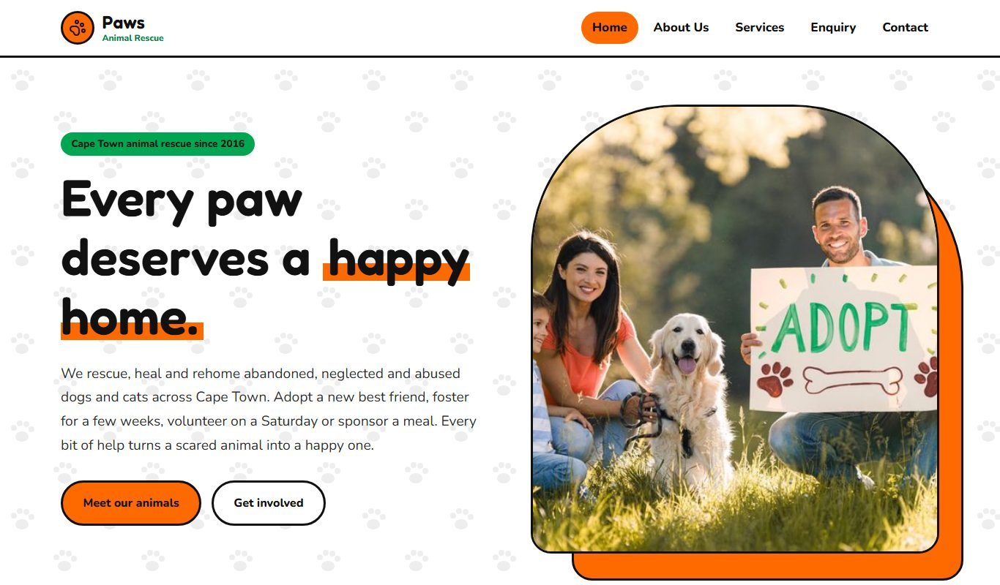
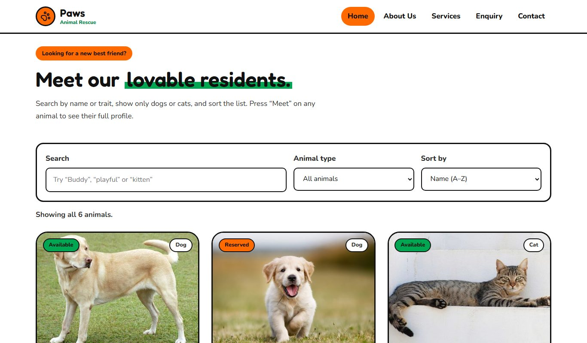
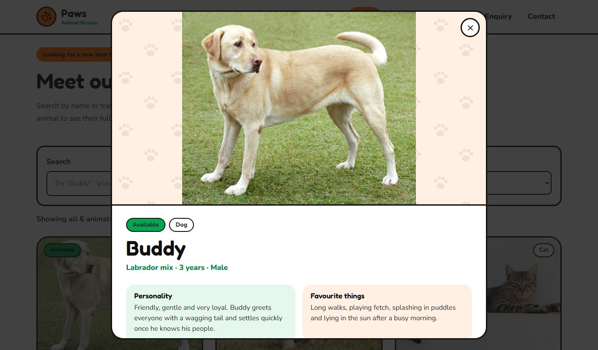
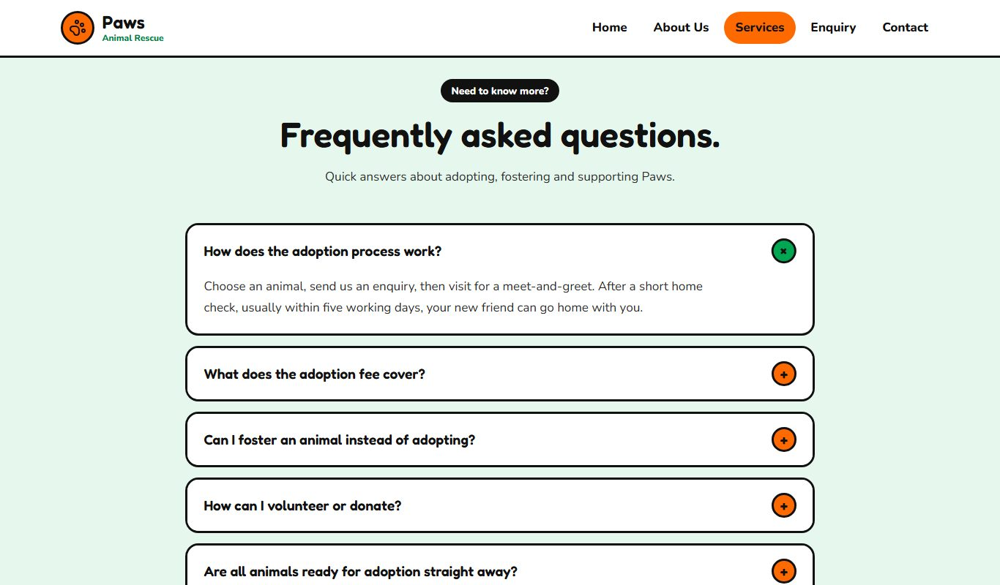
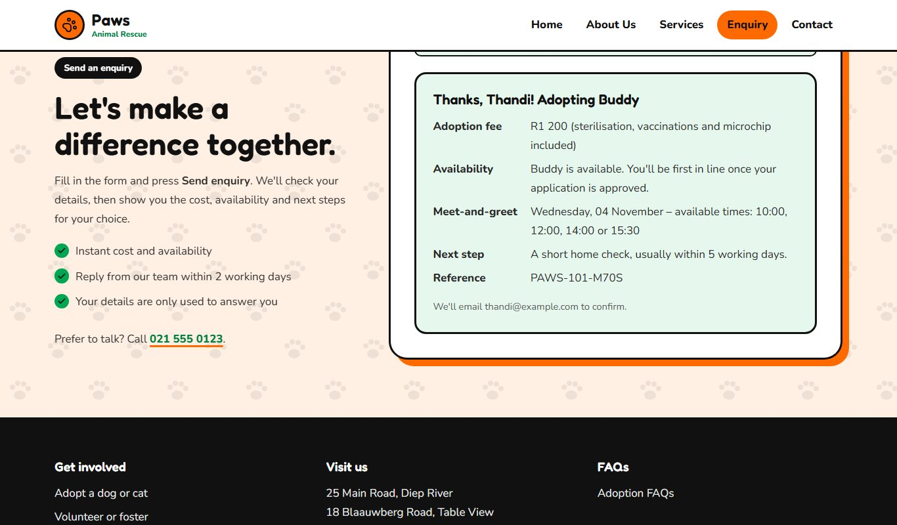
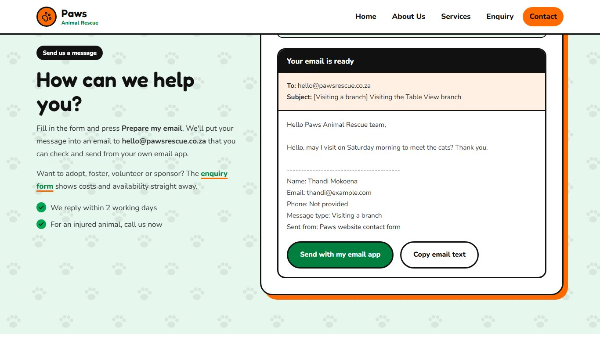
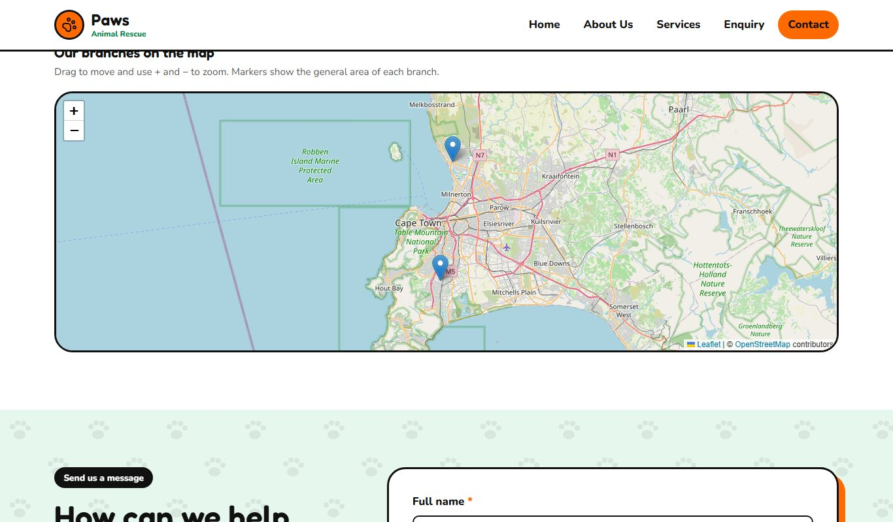
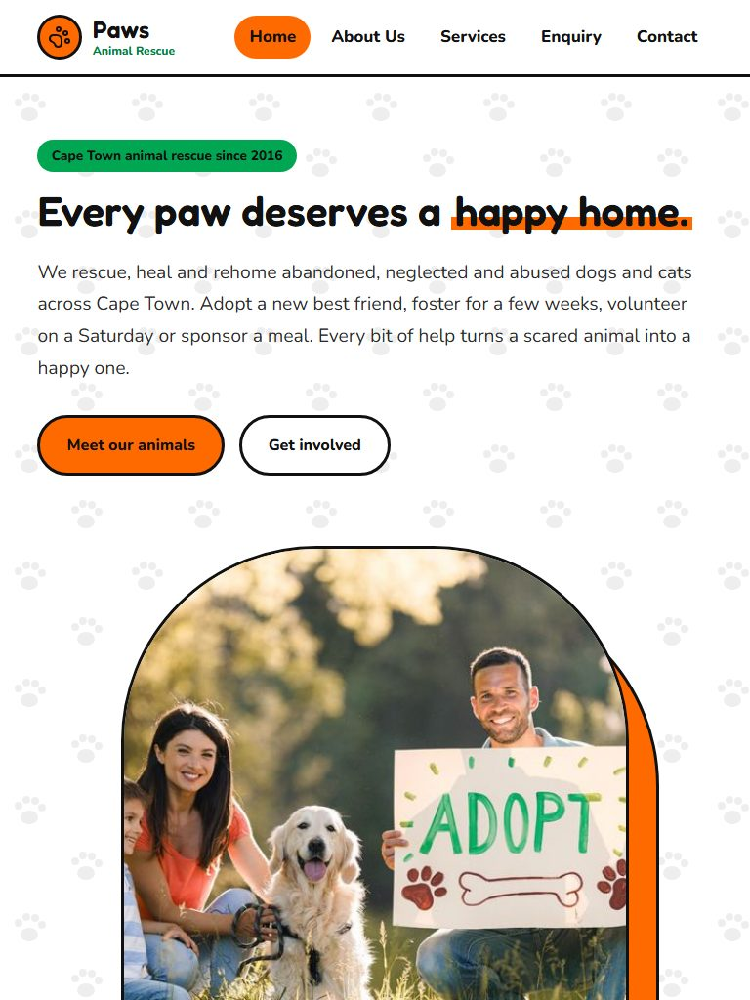
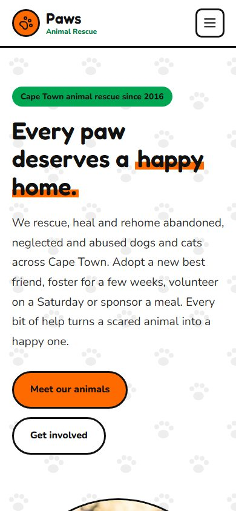
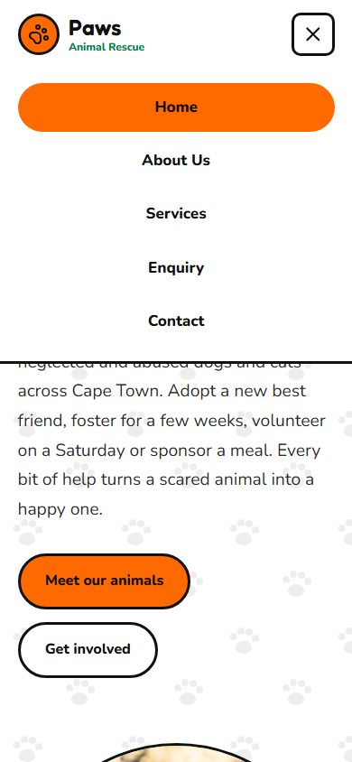

# Paws Animal Rescue Website

- **Live website:** <https://animal-rescue-website-part-3.vercel.app/>
- **Repository:** <https://github.com/Zipho-R/Animal-Rescue-Website-Part-3>

## 1. Project Overview

Paws Animal Rescue is a fictional non-profit animal rescue organisation based in Cape Town, South Africa. It rescues abandoned, neglected and abused animals and helps them find safe, permanent homes.

The website gives Paws a friendly online presence. Visitors can learn about the organisation, browse animals available for adoption, read about rescue services, enquire about adopting, fostering, volunteering or sponsoring, and contact the organisation.

The website was developed as part of an academic web development project (Parts 1–3).

The site is hosted on **Vercel**. Screenshots of the working site are in [Section 14](#screenshot-evidence).

---

## 2. Organisation

| | |
|---|---|
| **Name** | Paws Animal Rescue |
| **Type** | Non-Profit Organisation (NPO) |
| **Location** | Cape Town, South Africa (Diep River and Table View branches) |
| **Mission** | To protect vulnerable animals by providing rescue, care, rehabilitation and adoption services, while teaching the community about responsible pet ownership. |
| **Vision** | A Cape Town where every pet is wanted, sterilised and cared for, and where no animal is left abandoned, neglected or alone. |

---

## 3. Website Goals

- Increase awareness of animal rescue and welfare in Cape Town.
- Let visitors browse, search and filter animals available for adoption.
- Encourage adoption, fostering, volunteering and sponsorship.
- Give instant cost and availability information through the enquiry form.
- Make it easy to contact the organisation by email, phone or in person.
- Work well on desktop, tablet and mobile devices.

---

## 4. Target Audience

People interested in adopting a pet, animal lovers, potential volunteers, sponsors and donors, foster families, members of the Cape Town community, and anyone looking for information on animal welfare.

---

## 5. Website Pages

| Page | File | Main content |
|---|---|---|
| Home | `index.html` | Hero, moving ticker, introduction, services preview, **searchable animal directory with profile pop-ups**, adoption steps, testimonial, call to action |
| About Us | `about.html` | Our story, mission and vision, values, milestones timeline, team, **photo gallery with lightbox** |
| Services | `services.html` | Six services, **"Ways to help" tabs** with fees, adoption information, **FAQ accordion** |
| Enquiry | `enquiry.html` | Ways to get involved, **enquiry form** with validation, AJAX submission and a cost/availability response |
| Contact | `contact.html` | Two branch locations, **interactive Leaflet map**, **contact form that compiles an email**, opening hours |

---

## 6. Sitemap

```
Paws Animal Rescue
├── Home ............ index.html
├── About Us ........ about.html
├── Services ........ services.html
├── Enquiry ......... enquiry.html
└── Contact ......... contact.html
```

A machine-readable version for search engines is in `sitemap.xml`.

---

## 7. File and Folder Structure

```
Animal-Rescue-Website/
├── index.html
├── about.html
├── services.html
├── enquiry.html
├── contact.html
├── robots.txt            ← instructions for search engine crawlers
├── sitemap.xml           ← list of pages for search engines
├── vercel.json           ← security and caching headers for the live Vercel site
├── _headers              ← the same headers for Netlify (ignored by Vercel)
├── README.md
├── docs/
│   └── screenshots/      ← screenshots of the live website (used in this README)
├── css/
│   └── style.css
├── js/
│   ├── animals.js        ← animal data used to build the adoption cards
│   └── script.js         ← all interactive features and form handling
└── images/
    ├── labrador-buddy.jpg, tabby-cat-luna.jpg, ... (descriptive names)
    └── responsive/       ← 480w, 800w and 1200w versions of each photo
```

---

## 8. Technologies Used

- **HTML5**: semantic structure (`header`, `nav`, `main`, `section`, `article`, `aside`, `figure`, `footer`), forms and ARIA attributes.
- **CSS3**: custom properties (variables), Flexbox, Grid, `aspect-ratio`, `object-fit`, keyframe animations, media queries and `prefers-reduced-motion`.
- **JavaScript (ES6+)**: DOM manipulation, event delegation, `IntersectionObserver`, the Fetch API (AJAX), `FormData`, `URLSearchParams` and the Clipboard API.
- **Leaflet 1.9.4** with **OpenStreetMap** tiles for the interactive map.
- **Google Fonts**: Fredoka (headings) and Nunito (body text).
- **Lucide icons**: inline SVG icons (no emojis are used anywhere on the site).
- **JSONPlaceholder**: a free test API used to demonstrate AJAX form submission.

---

## 9. Design and Colour Scheme

Part 3 replaced the softer green/cream palette with a brighter, happier one built on four colours:

| Colour | Hex | Use |
|---|---|---|
| Orange | `#FF6A00` | Buttons, highlights and banners |
| Green | `#00A651` / dark `#007F3F` | Tags, links and the call-to-action band |
| Black | `#111111` | Text, outlines and the moving ticker |
| White | `#FFFFFF` | Main background |

Pale tints of orange and green separate the sections. Black text is used on orange and bright green, and white text only on dark green or black, so all text meets WCAG contrast guidelines.

Rounded fonts, thick black outlines and "sticker" shadows give the site a cheerful, playful character that suits a happy rescue organisation. A repeating paw-print pattern, a moving word ticker, gently floating banner photos and a scroll reveal add motion and fill the empty spaces. All animations stop automatically for visitors who turn on "reduce motion" in their device settings.

---

## 10. Part 3: Functionality (JavaScript)

| Requirement (Part 3 brief) | Where it is implemented |
|---|---|
| Accordion | FAQ on `services.html` (one +/× icon per question; opening one closes the others; keyboard accessible) |
| Tabs | "Ways to help" on `services.html` (Adopt / Foster / Volunteer / Sponsor; arrow-key navigation) |
| Modal | Animal profile pop-up on `index.html` (Escape to close, focus kept inside, returns focus afterwards) |
| Interactive map | Leaflet + OpenStreetMap on `contact.html`; "Show on map" buttons fly the map to each branch |
| Animations and transitions | Moving ticker, floating banner photos, scroll reveal, button and card hover effects, pop-in dialogs |
| Advanced DOM manipulation | Animal cards, filters, profile modal, lightbox, enquiry results and email preview are all built with `createElement`, `replaceChildren` and `textContent` |
| Gallery with lightbox | "Life at Paws" gallery on `about.html` (previous/next buttons, arrow keys, captions) |
| Dynamically loaded content | Adoption cards (`index.html`) and the animal list in the enquiry form are generated from `js/animals.js` |
| Search, filter and sort | Animal directory: search by name or trait, filter dogs/cats, sort by name, age or fee |

---

## 11. Part 3: Forms and Validation

### Enquiry form (`enquiry.html`)
Lets visitors enquire about **adopting, fostering, volunteering, sponsoring** or a general question.

- **Smart fields:** only the relevant fields appear for each enquiry type (animal list, sponsorship amount, volunteer area, visit date).
- **Validation:** required fields; names (letters only, 2–50 characters); email format; South African phone format (`082 123 4567` or `+27 82 123 4567`), which becomes required if "Phone call" is chosen; a visit date from tomorrow to 60 days ahead and not on a Sunday; a sponsorship amount from R50 to R50 000; a message of 20–1 000 characters with a live counter; and a consent checkbox.
- **Error handling:** a clear red message under each field, live re-checking as the visitor types, and focus moved to the first problem.
- **AJAX submission:** valid data is sent in the background with `fetch()` to the URL in the form's `action` attribute (`https://jsonplaceholder.typicode.com/posts`), without reloading the page. The returned ID creates a reference number.
- **Processed response:** the visitor sees the **cost** (adoption fee, sponsorship total and what it pays for, or free for fostering and volunteering), **availability** (whether the animal is available or reserved, meet-and-greet times for the chosen day, volunteer shifts) and the next steps. If the server cannot be reached, the response is still shown with a note.
- Arriving from an "Apply to adopt" button pre-fills the enquiry type and animal.

### Contact form (`contact.html`)
For general messages to the organisation.

- Fields: full name, email, optional phone, **type of message** (general, lost/found animal, visit, donation, feedback, media) and subject, plus a full message (20–1 500 characters).
- After validation, the details are **compiled into an email** addressed to `hello@pawsrescue.co.za` (set in `js/script.js`). The visitor sees a preview and can press **Send with my email app** (a `mailto:` link with the subject and body filled in) or copy the text.
- The form's `action` is `mailto:hello@pawsrescue.co.za`, so it still works as a basic email form if JavaScript is off.

---

## 12. Part 3: Search Engine Optimisation (SEO)

### On-page SEO
- **Keyword research:** target phrases were chosen for local searches, such as *animal rescue Cape Town*, *adopt a dog Cape Town*, *adopt a cat*, *foster animals Cape Town*, *volunteer at animal shelter* and *pet adoption fees*. They appear naturally in titles, headings, descriptions and body text.
- **Title tags and meta descriptions:** each page has a unique title under 60 characters and a description under 160 characters.
- **Header tags:** each page has exactly one `<h1>`, followed by `<h2>` section headings and `<h3>` card headings.
- **Image optimisation:** images were renamed descriptively (for example `dog-2.jpg` became `labrador-buddy.jpg`), compressed, and given detailed alt text, `width`/`height` attributes and responsive `srcset` versions.
- **Clean URLs:** short, lowercase, descriptive file names (`about.html`, `services.html`, and so on).
- **Internal linking:** contextual links between pages (service cards link to `services.html#…`, footer links to the enquiry form, contact page and FAQs, "Apply to adopt" links to the enquiry form). The footer does not repeat the main navigation links..
- **Mobile-friendliness:** responsive layouts at 1000px, 760px and 420px, a mobile menu, and touch-sized buttons.

### Off-page SEO
- **Social media:** Open Graph and Twitter Card tags so shared links display a title, description and image.
- **Local SEO:** `AnimalShelter` structured data (JSON-LD) with both addresses, phone number and opening hours; `geo` meta tags; addresses, phone numbers and the map on the Contact page.
- **Backlinks (plan):** listing Paws on Cape Town pet directories, local vet and pet shop partner websites, and community notice boards; guest posts on local pet blogs; and the deployed site link in social media bios.

### Additional requirements
- **robots.txt:** allows all pages to be crawled and points to `https://animal-rescue-website-part-3.vercel.app/sitemap.xml`.
- **sitemap.xml:** lists all five pages as absolute Vercel URLs, with priorities and last-modified dates.
- **Canonical URLs:** every page has a `<link rel="canonical">` and an `og:url` with its full Vercel address, and `og:image` uses an absolute URL so link previews can load the photo.
- **Page speed:** compressed images in 480/800/1200px sizes, lazy loading below the fold, `fetchpriority="high"` on the main image, deferred scripts, font `preconnect` with `display=swap`, and cache headers in `vercel.json`. Images are cached for a week, so a replaced image must be given a new file name. CSS and JavaScript use `max-age=0, must-revalidate`: their file names do not change when they are edited, so the browser checks for a newer version on every visit and gets a quick "304 Not Modified" reply when nothing has changed.
- **Security:** a Content-Security-Policy restricts which sites can supply scripts, styles, images and form submissions; Subresource Integrity on the Leaflet files; `rel="noopener noreferrer"` on external links; all visitor input is shown with `textContent` (never `innerHTML`) to prevent cross-site scripting; input lengths are limited; and security headers (`X-Frame-Options`, `X-Content-Type-Options`, `Referrer-Policy`, `Permissions-Policy`) are set in `vercel.json`. Vercel adds HTTPS and `Strict-Transport-Security` automatically.

`robots.txt`, `sitemap.xml`, the canonical tags and the structured data all point to the live address: `https://animal-rescue-website-part-3.vercel.app/`.

---

## 13. Accessibility

Skip-to-content link; visible keyboard focus; labelled form fields with `aria-describedby` errors and hints; `aria-expanded`, `aria-controls`, `aria-selected` and `role="dialog"` on interactive components; focus trapped inside dialogs (Tab and Shift+Tab loop inside, Escape closes) and returned to the button that opened them; descriptive alt text; and reduced-motion support.

**Colour contrast** was measured in the browser against WCAG 2.2 AA on every page and in every pop-up, tab, FAQ, form error state and form result. All text meets 4.5:1 (3:1 for large text), including the worst case where a paw print in the background pattern sits behind the text; the lowest is 4.58:1. Every one of the 185 focusable elements has a focus indicator of at least 3:1 against its background (WCAG 1.4.11). Text inside photographs is not included, as WCAG exempts it.

---

## 14. Testing

The website was tested in a browser at desktop (1366px) and mobile (390px) widths. The checks covered:

- Navigation and the mobile menu on every page.
- Search, filter and sort in the animal directory (including the "no results" message).
- Animal profile pop-ups (correct photo and details, Escape and close button).
- The FAQ accordion (one icon per question, only one open at a time) and the tabs.
- The gallery lightbox (next/previous, arrow keys, Escape).
- Enquiry form: invalid entries show the correct error messages; valid entries show the cost/availability response; pre-filling from "Apply to adopt" works.
- Contact form: validation errors, the compiled `mailto:` link and the email preview.
- No horizontal scrolling on mobile; no JavaScript errors in the console.
- Every page has one `<h1>`, no duplicate IDs, alt text on all images and no broken local links.

### Automated browser checks (2 November 2026)
The interactive features were also tested automatically in headless Google Chrome, which clicked, typed and pressed keys on the pages the same way a visitor would. All 29 checks passed, with no JavaScript errors or Content-Security-Policy violations on any page:

| Page | What was checked |
|---|---|
| Home | Cards built from `animals.js`; search ("luna"); "no results" message; dogs/cats filter; sorting; profile pop-up opens with photo, details and fee; focus moves into the pop-up; Escape closes it |
| Services | Tabs switch panels; FAQ opens; opening another FAQ closes the first |
| About | Gallery lightbox opens; arrow key shows the next photo; Escape closes it |
| Enquiry | Empty form shows field errors; a valid adoption enquiry shows the cost and availability response |
| Contact | Leaflet map loads tiles and both branch markers; empty form shows errors; a valid message is compiled into a `mailto:` email |
| Mobile (390px) | Menu button shows, opens the menu and changes to a close icon; no horizontal scrolling |

Two further browser checks (2 November 2026, after the accessibility fixes) confirmed that clicking "Apply to adopt" or "Join waiting list" for each of the six animals, and the link inside the profile pop-up, pre-fills the enquiry type and animal; and that in both dialogs Tab and Shift+Tab stay inside, Escape closes, and focus returns to the button that opened the dialog, including after moving to another photo in the lightbox.

A separate check confirmed that all 220 local file and link references (pages, images, `srcset` sizes, CSS and scripts) exist, every page has one `<h1>` and no duplicate IDs, and every URL in `sitemap.xml` loads on the live site.

### Screenshot Evidence
These screenshots were taken from the live site (<https://animal-rescue-website-part-3.vercel.app/>) on 2 November 2026.

| Home page (desktop) | Animal directory with search, filter and sort |
|---|---|
|  |  |
| **Animal profile pop-up** | **FAQ accordion (Services page)** |
|  |  |
| **Enquiry form: cost and availability response** | **Contact form: compiled email** |
|  |  |
| **Contact page: interactive Leaflet map** | **Tablet layout (768px)** |
|  |  |
| **Mobile layout (390px)** | **Mobile navigation menu** |
|  |  |

### Known limitations
- **Forms do not reach a real inbox.** The enquiry form sends its data to JSONPlaceholder, a free test API, so the AJAX request and response are real but nothing is stored. The contact form opens the visitor's own email app with the message filled in; it does not send the email itself.
- **The Content-Security-Policy is set with a `<meta>` tag** so it works on any host. A meta tag cannot set `frame-ancestors`, so protection against the site being shown inside another site's frame comes from the `X-Frame-Options: DENY` header in `vercel.json`.
- **The map depends on two outside services** (unpkg for Leaflet and OpenStreetMap for tiles). If either is unavailable, the page shows the branch addresses instead.

---

## 15. Deployment

1. Push all files to the GitHub repository.
2. **Vercel (chosen host):** vercel.com → Add New → Project → import this GitHub repository → Framework preset *Other*, no build command → Deploy. Vercel redeploys automatically on every push to `main`.
   **or GitHub Pages:** Settings → Pages → Source: *Deploy from a branch* → `main` / root → Save.
   **or Netlify:** Add new site → Import from GitHub → choose the repository → Deploy (no build command needed; `_headers` is applied automatically).
3. The live link (`https://animal-rescue-website-part-3.vercel.app/`) is set in this README, `robots.txt`, `sitemap.xml` and the canonical tags.
4. Vercel reads the security and caching headers from `vercel.json` (it ignores `_headers`). After deploying, check that they are active by running `curl -I https://animal-rescue-website-part-3.vercel.app/` or by opening the browser developer tools → Network → the page request → Response Headers, and looking for `X-Frame-Options`, `X-Content-Type-Options`, `Referrer-Policy` and `Permissions-Policy`.
5. Optional: submit `sitemap.xml` in Google Search Console.

---

## 16. Future Improvements

Online donations, a real database and admin dashboard for animals, volunteer accounts, online booking for meet-and-greets, a newsletter, and server-side email delivery for both forms.

---

## 17. Changelog

### Part 3 Edits: Enhancing Functionality and SEO

#### Summary of improvements from Part 2

| Area | Part 2 | Part 3 |
|---|---|---|
| Colour scheme | Muted green, coral, yellow, pink and cream | Bright orange `#FF6A00`, green `#00A651`, black and white with WCAG-compliant contrast |
| Typography | Arial / system fonts | Google Fonts: Fredoka (headings) and Nunito (body) |
| Images | Generic names (`dog-2.jpg`, `team1.jpg.webp`), some mismatched with their text, blank bands from `object-fit: contain` | Descriptive names (`labrador-buddy.jpg`), photos matched to names/ages/alt text, fixed-shape frames with `object-fit: cover`, regenerated 480/800/1200w versions |
| Home page | Static featured-animal cards | Searchable, filterable and sortable animal directory built from `js/animals.js`, with profile pop-ups, ticker, adoption steps and testimonial |
| About page | Story, mission, values, team | Adds milestones timeline, team bios and a photo gallery with lightbox |
| Services page | Six service cards | Adds "Ways to help" tabs with fees and a FAQ accordion (double "+" icon fixed) |
| Enquiry form | Required-field check and a generic confirmation | Conditional fields, format validation, per-field errors, AJAX `fetch()` submission and a cost/availability response |
| Contact form | Required-field check only; map placeholder | Message-type field, validation, compiled `mailto:` email with preview; working Leaflet map (missing script added) |
| SEO | Basic titles, no meta descriptions strategy, no robots/sitemap | Keyword-based titles and descriptions, Open Graph/Twitter tags, JSON-LD local business data, `robots.txt`, `sitemap.xml` |
| Security and speed | None | Content-Security-Policy, security and cache headers in `vercel.json`, SRI on Leaflet, `textContent` output, lazy loading, deferred scripts |

The interim commit "Add interactive Part 3 website features" (an early draft of the contact map, homepage and services changes) was replaced by the final versions of those files described below.

#### Corrections and feedback-related fixes
- **FAQ showed two plus signs:** the CSS drew a "+" with `.faq-question::after` and the HTML also contained a `+` span. The `::after` rule was removed, so each question now has one round +/× icon that rotates when opened. Each question is linked to its answer with `aria-controls`.
- **Animal profile images displayed badly:** the pop-up photo was forced to `object-fit: cover` in a narrow column with a 420px minimum height, so photos were heavily cropped. The pop-up now shows the whole photo (`object-fit: contain`) above the details at full resolution using `srcset`, with Dog/Cat and availability badges.
- **Wrong photos on animals:** Buddy (3 years) had a puppy photo and Milo (8 months) had an adult Labrador photo. The photos were swapped to match the descriptions.
- **Empty spaces around images:** all images used `object-fit: contain`, which left blank bands. Content images now sit in fixed-shape frames with `object-fit: cover`, so cards in a row are always the same height.
- **Homepage introduction layout:** the intro container was missing the `two-column` class, so the image and text were stacked with a large gap. Fixed.
- **Map never appeared:** `contact.html` loaded the Leaflet CSS but not the Leaflet JavaScript file. The script was added (with Subresource Integrity), plus a text fallback if the map cannot load.
- **Blurry hero image:** a 640px image was stretched across the full screen. The hero was redesigned around a 1 600px photo.
- **Mismatched images and alt text on the Services page:** the "Animal Rescue" card showed the rehabilitation photo and vice versa. Images and alt text now match each service.
- **Team details:** "Daniel Jacobs" was shown with a photo of a woman; renamed to Danielle Jacobs.
- **Unused file:** `volunteer.jpg` (a phone screenshot) was not used on any page and was removed.

#### Design
- New brighter palette of orange, green, black and white (see Section 9), replacing the muted greens, coral and cream.
- Added Google Fonts (Fredoka and Nunito) for a friendlier look than Arial.
- Filled empty spaces with more content and motion: a moving word ticker, circular photos in every page banner, a paw-print background pattern, an adoption steps section, a testimonial, a milestones timeline and a photo gallery.
- Added more text throughout: longer introductions, card descriptions, team bios, location details and six FAQs.

#### Functionality (JavaScript)
- Animal directory rebuilt from data in `js/animals.js` (dynamic content). Added two more animals (Daisy and Snowy) and a bonded pair (Pip & Pepper) using existing images, an extra "Lowest fee" sort option, trait search and a "no results" message.
- Added interactive tabs, a gallery lightbox and a scroll reveal.
- Map: branch markers fit the view automatically; "Show on map" buttons on each location card.
- Opening hours highlight today's day automatically.
- Mobile menu button now updates `aria-expanded` and switches between a menu icon and a close icon.

#### Forms
- Enquiry form: conditional fields, full format validation, per-field error messages, live character counter, AJAX submission with `fetch()`, and a cost/availability response (see Section 11).
- Contact form: added phone and message-type fields, validation and error messages, and compiling the message into an email with a preview and a `mailto:` send button.
- Both forms now have `action` and `method` attributes.

#### SEO and performance
- Rewrote every title tag and meta description around researched keywords; added keyword, Open Graph, Twitter Card and geo meta tags.
- Added `AnimalShelter` structured data (JSON-LD) for local SEO.
- Renamed all images descriptively; regenerated compressed responsive versions; added `width`/`height`, lazy loading and `fetchpriority`.
- Added `robots.txt` and `sitemap.xml`.
- Scripts now load with `defer`.

#### Security
- Added a Content-Security-Policy and referrer policy meta tags on every page, `_headers` with security headers, Subresource Integrity on Leaflet, `rel="noopener noreferrer"` on external links, and safe `textContent` output for all user input.

#### Home page and footer clean-up
- **Removed the made-up statistics:** the green statistics band on `index.html` (1 240+ animals rehomed, 180 volunteers, 65 foster families, 2 branches) and the two floating stickers on the hero photo ("1 240+ happy adoptions" and "6 pets waiting for you") were removed, because the figures were not real. The unused counter script and the stats/sticker styles were deleted from `js/script.js` and `css/style.css`.
- **Simpler footer on every page:** the footer now has only three columns: *Get involved* (adopt, volunteer or foster, sponsor, contact), *Visit us* (both addresses, phone and email) and *FAQs* (link to the adoption FAQs). The logo, tagline and social media icons were removed, and the "Explore" links (Home, About us, Our services) were removed because they repeat the navigation bar.

#### Emojis replaced with icons
- **All emojis removed:** emojis display differently on every device (and sometimes not at all), and screen readers can read them out. Every emoji in the HTML, CSS and JavaScript was removed.
- **SVG icons instead:** where an icon helps, the emoji was replaced with an inline SVG icon from the open-source Lucide icon set (paw print logo and favicon, menu and close buttons, card icons such as house, sofa, hand, heart, stethoscope, sprout, lifebuoy, target, globe, shield, sun and map pin, and check marks). The icons are drawn in the HTML, so they need no extra download and are allowed by the Content-Security-Policy. They use `currentColor`, so they follow the site's colours, and they have `aria-hidden="true"` so screen readers skip them.
- **Emoji with no icon:** the dog/cat emojis on the animal badges, the paw at the start of the enquiry notice and the tick after "Copied" were removed; the text alone is used.

#### Accessibility fixes (colour contrast and focus)
Measuring the site against WCAG 2.2 AA found several colours below the required contrast. Each was fixed and re-measured:

| Problem | Before | Fix | After |
|---|---|---|---|
| Orange focus outline on light backgrounds | 1.78–2.87:1 (needs 3:1) | Focus outline is now black; the footer, tab bar and photo viewer keep orange because black would not show on their dark backgrounds | 3.69–18.88:1 |
| Checkboxes and radio buttons showed only a faint green glow when focused | 1.33:1 | Added a black outline for focused checkboxes and radio buttons | 18.88:1 |
| Orange required-field asterisk (*) | 2.87:1 (needs 4.5:1) | Asterisk changed to dark red `#B42318` | 6.14–6.57:1 |
| "Available" badge text in the profile pop-up | 4.43:1 | Badge text changed to black | 5.91:1 |
| Placeholder text in fields with an error | 4.30:1 | Placeholder colour set to `#6B6B6B` | 4.98:1 (5.33:1 without an error) |
| Green links on the paw-print pattern, where a paw sits behind the text | 3.97:1 | These links use a darker green `#006B35` | 5.17:1 or more |

- **Lightbox focus:** closing the photo viewer now returns focus to the photo that opened it, even after moving to other photos with the arrow buttons (before, focus went to the last photo viewed).

#### Navigation and hero clean-up
- Removed the "Adopt a pet" button from the navigation bar on every page. Visitors reach the animals through the "Meet our animals" button and the Home page.
- Removed the four hero points (Sterilised, Vaccinated, Microchipped, Lifetime support) from the Home page hero, to keep the hero focused on the main message and buttons.

#### Pre-submission review: live URL, headers and evidence
- **Live URL corrected:** `robots.txt`, `sitemap.xml` and this README pointed to an old GitHub Pages address from Part 2 (`https://zipho-r.github.io/Animal-Rescue-Website-Part-2/`) that was never used. They now use the live Vercel address `https://animal-rescue-website-part-3.vercel.app/`, and the repository link uses the renamed `Animal-Rescue-Website-Part-3` repository.
- **Canonical and social URLs added:** each page now has a canonical link and an `og:url` with its full address; `og:image` was changed from a relative path to an absolute URL so link previews can load it; the Home page structured data now includes the site `url`.
- **Vercel security-header configuration added:** the site's headers were in `_headers`, which only Netlify reads, so the live site was not sending them (checked with `curl -I` before the change). Added `vercel.json` with `X-Frame-Options`, `X-Content-Type-Options`, `Referrer-Policy` and `Permissions-Policy` for all pages. HSTS is not repeated because Vercel already sends a stronger one. No second Content-Security-Policy header was added, because the existing meta tag already applies on every page and a second policy could block resources.
- **Caching corrected:** images stay cached for a week (a replaced image must use a new file name). CSS and JavaScript were changed from a one-week cache to `max-age=0, must-revalidate`, because their file names stay the same when they are edited and any longer cache could show old styles or scripts with new pages after an update. `_headers` was updated to match and its comment now explains that it is only for Netlify.
- **Screenshot evidence added:** the placeholder was replaced with ten real screenshots of the live site in `docs/screenshots/`, plus the results of the automated browser checks and a list of known limitations.

#### Documentation
- README updated with Part 3 functionality, forms, SEO, deployment instructions, this changelog and a references list.

### Part 2 Edits

- **Relative units for spacing (Section 3.2 of the brief):** Converted every `padding`, `margin` and `gap` value in `css/style.css` from fixed pixel values to `rem` units (base 16px), so that spacing scales consistently with the root font size rather than being fixed in pixels. The header's fixed height (`min-height`) and the mobile navigation dropdown's matching `top` offset were converted together, since the second value depends on the first. Font sizes already used `rem`/`clamp()` and were left as-is. Border widths, border-radius, box-shadow offsets and fixed icon/image dimensions were intentionally left in pixels, as these are decorative/structural values rather than spacing.

- **Responsive images with `srcset`, `sizes` and `<picture>` (Section 3.3 of the brief):** Previously, all `` elements linked directly to a single full-size source file, so mobile devices downloaded the same large image as desktop. Using Python/Pillow, smaller width variants (480w, 800w and, where the source was large enough, 1200w) were generated for every content image and saved to `images/responsive/`. Every `` tag on `index.html`, `about.html` and `services.html` was updated with a `srcset` and `sizes` attribute so the browser can choose the most appropriately sized image for the viewport. The two large "story" images (on the homepage introduction and the About Us page) were additionally wrapped in a `<picture>` element to demonstrate that responsive image technique specifically.

- **Changelog section added:** Added this Changelog section to the README so that future edits (including corrections from marker feedback) can be recorded here, as required by the Part 2 brief.

- **Screenshot evidence placeholder added:** Added a "Screenshot Evidence" subsection under Testing (Section 16) noting the breakpoints tested and where screenshots of desktop/tablet/mobile views should be inserted. Actual screenshots still need to be captured directly from a browser's device toolbar and added to the repository, since this is evidence of the student's own manual testing process.

### Notes

The CSS reset, base styles, typography scale, Flexbox/Grid layout, `:hover`/`:focus`/`:active` interactive states, and the tablet/mobile media query breakpoints (1000px and 700px) from Part 1 were reviewed and found to already satisfy the Part 2 requirements, so they were left unchanged.

---

## 18. References

Google, 2026. *Create and submit a sitemap*. [online] Google Search Central. Available at: <https://developers.google.com/search/docs/crawling-indexing/sitemaps/build-sitemap> [Accessed 2 November 2026].

Google, 2026. *Introduction to robots.txt*. [online] Google Search Central. Available at: <https://developers.google.com/search/docs/crawling-indexing/robots/intro> [Accessed 2 November 2026].

Google, 2026. *Search Engine Optimization (SEO) Starter Guide*. [online] Google Search Central. Available at: <https://developers.google.com/search/docs/fundamentals/seo-starter-guide> [Accessed 2 November 2026].

Google Fonts, 2026. *Fredoka* and *Nunito*. [online] Available at: <https://fonts.google.com> [Accessed 2 November 2026].

JSONPlaceholder, 2026. *Free fake and reliable API for testing and prototyping*. [online] Available at: <https://jsonplaceholder.typicode.com> [Accessed 2 November 2026].

Leaflet, 2026. *Leaflet: an open-source JavaScript library for interactive maps* (version 1.9.4). [online] Available at: <https://leafletjs.com> [Accessed 2 November 2026].

Lucide, 2026. *Lucide icons* (ISC licence). [online] Available at: <https://lucide.dev> [Accessed 2 November 2026].

MDN Web Docs, 2026. *Client-side form validation*. [online] Mozilla. Available at: <https://developer.mozilla.org/en-US/docs/Learn/Forms/Form_validation> [Accessed 2 November 2026].

MDN Web Docs, 2026. *Content Security Policy (CSP)*. [online] Mozilla. Available at: <https://developer.mozilla.org/en-US/docs/Web/HTTP/CSP> [Accessed 2 November 2026].

MDN Web Docs, 2026. *Using the Fetch API*. [online] Mozilla. Available at: <https://developer.mozilla.org/en-US/docs/Web/API/Fetch_API/Using_Fetch> [Accessed 2 November 2026].

MDN Web Docs, 2026. *Intersection Observer API*. [online] Mozilla. Available at: <https://developer.mozilla.org/en-US/docs/Web/API/Intersection_Observer_API> [Accessed 2 November 2026].

Netlify, 2026. *Custom headers*. [online] Available at: <https://docs.netlify.com/routing/headers/> [Accessed 2 November 2026].

OpenStreetMap contributors, 2026. *OpenStreetMap*. [online] Available at: <https://www.openstreetmap.org/copyright> [Accessed 2 November 2026].

Schema.org, 2026. *AnimalShelter*. [online] Available at: <https://schema.org/AnimalShelter> [Accessed 2 November 2026].

Vercel, 2026. *Configuring projects with vercel.json: headers*. [online] Available at: <https://vercel.com/docs/project-configuration#headers> [Accessed 2 November 2026].

W3C, 2024. *ARIA Authoring Practices Guide: Accordion, Tabs and Dialog (Modal) patterns*. [online] Available at: <https://www.w3.org/WAI/ARIA/apg/patterns/> [Accessed 2 November 2026].

### Image references
All photographs in the `images` folder were found through a Google Images search. They are used for educational, non-commercial purposes only and remain the property of their original owners. Files were renamed descriptively and resized for this project.

Google Images, 2026. *Cat recovering with a bandaged paw* [Photograph]. Available at: <https://images.google.com> [Accessed September 2026]. (`images/cat-recovering-with-bandaged-paw.jpg`)

Google Images, 2026. *Family adopting a rescue dog* [Photograph]. Available at: <https://images.google.com> [Accessed September 2026]. (`images/family-adopting-rescue-dog.jpg`)

Google Images, 2026. *Feeding a rescued dog and cat* [Photograph]. Available at: <https://images.google.com> [Accessed September 2026]. (`images/feeding-rescued-dog-and-cat.jpg`)

Google Images, 2026. *Foster family with a rescue dog* [Photograph]. Available at: <https://images.google.com> [Accessed September 2026]. (`images/foster-family-with-rescue-dog.jpg`)

Google Images, 2026. *Golden puppy running* [Photograph]. Available at: <https://images.google.com> [Accessed September 2026]. (`images/golden-puppy-daisy-running.jpg`)

Google Images, 2026. *Golden retriever puppy* [Photograph]. Available at: <https://images.google.com> [Accessed September 2026]. (`images/golden-retriever-puppy-milo.jpg`)

Google Images, 2026. *Labrador dog* [Photograph]. Available at: <https://images.google.com> [Accessed September 2026]. (`images/labrador-buddy.jpg`)

Google Images, 2026. *Animal shelter volunteer team* [Photograph]. Available at: <https://images.google.com> [Accessed September 2026]. (`images/paws-volunteer-team.jpg`)

Google Images, 2026. *Tabby cat* [Photograph]. Available at: <https://images.google.com> [Accessed September 2026]. (`images/tabby-cat-luna.jpg`)

Google Images, 2026. *Portrait photograph used for a team member* [Photograph]. Available at: <https://images.google.com> [Accessed September 2026]. (`images/team-danielle-jacobs.jpg`)

Google Images, 2026. *Portrait photograph used for a team member* [Photograph]. Available at: <https://images.google.com> [Accessed September 2026]. (`images/team-mia-petersen.jpg`)

Google Images, 2026. *Portrait photograph used for a team member* [Photograph]. Available at: <https://images.google.com> [Accessed September 2026]. (`images/team-sarah-williams.jpg`)

Google Images, 2026. *Veterinarians examining a rescue dog* [Photograph]. Available at: <https://images.google.com> [Accessed September 2026]. (`images/vets-examining-rescue-dog.jpg`)

Google Images, 2026. *Volunteer hugging a rescue dog* [Photograph]. Available at: <https://images.google.com> [Accessed September 2026]. (`images/volunteer-hugging-rescue-dog.jpg`)

Google Images, 2026. *White kitten* [Photograph]. Available at: <https://images.google.com> [Accessed September 2026]. (`images/white-kitten-snowy.jpg`)

Google Images, 2026. *Pair of Yorkshire terriers* [Photograph]. Available at: <https://images.google.com> [Accessed September 2026]. (`images/yorkie-pair-pip-and-pepper.jpg`)
